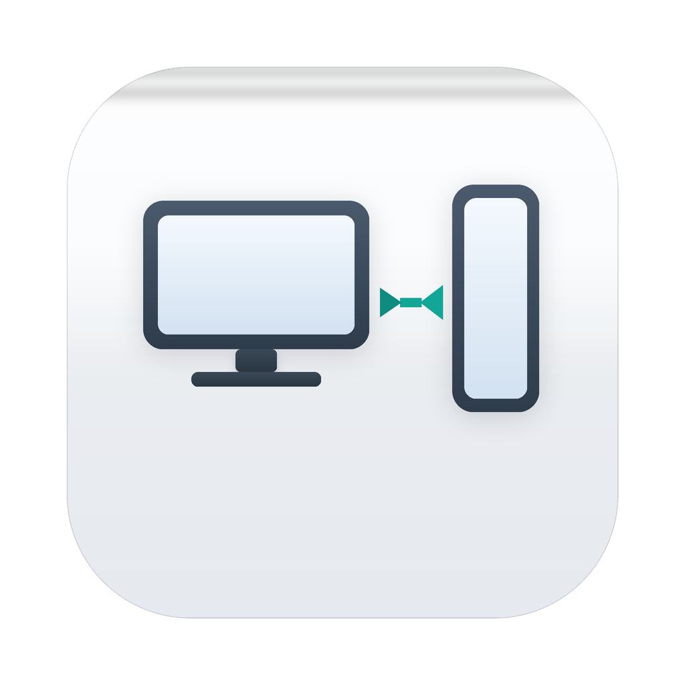
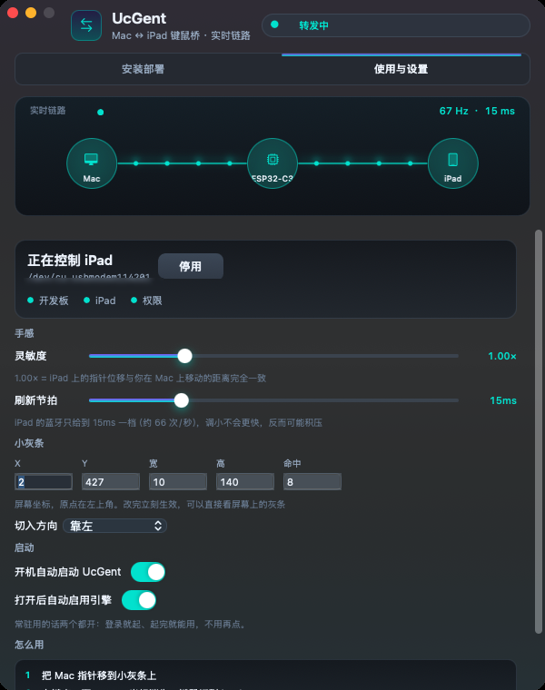
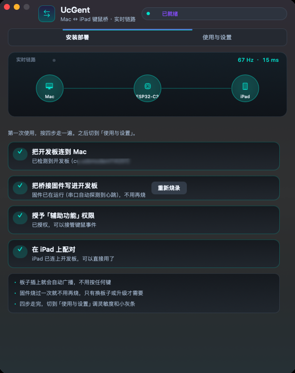

<p align="center">
  
</p>

<h1 align="center">UcGent</h1>

<p align="center">用 Mac 的键盘和鼠标，直接控制 iPad。不需要通用控制，也不需要同一个 Apple ID。</p>

<p align="center">
  
  
  
</p>

> 本仓库仅用于产品展示与问题反馈，**不包含源代码**（闭源软件）。
>
> 与 Apple 无关联。「通用控制」是 Apple 的功能名称，这里仅用于说明实现方式不同。

---

## 是什么

UcGent 让 Mac 的键盘和鼠标可以直接操作 iPad。中间靠一块十几块钱的 ESP32 开发板做蓝牙 HID 桥接，iPad 眼里它就是一套普通的蓝牙键盘 + 鼠标，**iPad 上不需要安装任何 App**。

和 Apple 的通用控制相比，它不要求两台设备登录同一个 Apple ID，也不挑 macOS / iPadOS 版本；代价是需要一块开发板和一根 USB 线。

## 工作方式

```
Mac 键鼠事件 → USB 串口 → ESP32-C3 → 蓝牙 HID → iPad
```

Mac 端是一个常驻菜单栏的 App，负责截获键鼠、维护串口连接与切换状态；开发板负责把串口数据转成标准蓝牙 HID 报告。全程不经过 iCloud、不依赖 Wi-Fi，也不使用连续互通那套通道。

## 功能

- **一套键鼠控两台设备**：Mac 指针移到屏幕边缘的小灰条上点一下，光标切到 iPad；往反方向推鼠标，或按 `⌥⌘←` 切回 Mac。
- **iPad 零安装**：配对一次即可，iPad 侧只当成蓝牙键盘/鼠标。
- **菜单栏常驻**：没有 Dock 图标，菜单栏图标就是状态灯——白色表示引擎在跑，灰色表示未授权或已停用。
- **四步安装向导**：连开发板 → 烧固件 → 授予辅助功能 → iPad 蓝牙配对，每一步自动检测打勾。
- **固件内置**：烧录器和固件打包在 App 里，不需要装 Arduino、Python 或任何开发环境；已经烧过的板子会自动识别，不用重烧。
- **可调参数**：灵敏度（1.00× 为 1:1）、刷新节拍（跟随 iPad 的 15ms 上限）、小灰条的位置/宽高/命中范围/靠左或靠右。
- **开机自启 + 自动启用**：登录后自动常驻、自动挂上引擎，不用每次手动点。
- **安全退出**：退出或停用时会自动还原光标、释放按键，不在 iPad 上留下卡住的修饰键。
- **可选桌宠**：带 OLED 的开发板会显示一个随状态变化的小表情。

## 界面



> 「使用与设置」页：总开关、状态圆点（开发板 / iPad / 权限）、灵敏度、刷新节拍、小灰条参数与启动项。



> 「安装部署」页：开发板、固件、辅助功能权限、iPad 配对四步自动检测，全绿即可用。

## 硬件要求

| 项 | 要求 |
|---|---|
| 开发板 | **ESP32-C3 Supermini**（约 15–25 元），原生 USB、BLE 5.0 |
| 备选 | ESP32-S3 / C6 / WROOM-32 也能用；**ESP8266 不行**（没有蓝牙） |
| 连接 | 一根能传数据的 USB-C 线（很多充电线只有电源） |
| Mac | macOS 13 或更高，需授予「辅助功能」权限 |
| iPad | 支持蓝牙键盘/鼠标的 iPadOS 版本 |

## 使用

1. 用数据线把开发板连到 Mac，App 会自动识别串口。
2. 点「开始烧录」，等待 3–5 秒；已烧过的板子会自动跳过。
3. 系统设置 → 隐私与安全性 → 辅助功能 → 勾选 UcGent。
4. iPad → 设置 → 蓝牙 → 选择 `UC Bridge` 配对。
5. 点「启用引擎」，把 Mac 指针移到小灰条上点一下即可切到 iPad。

## 已知限制

- **指针刷新跟随蓝牙上限**：iPad 协商到的 BLE 连接间隔是 15ms（约 66 次/秒），调小不会更快，只会积压。
- **辅助功能权限与签名绑定**：App 被移动或重新签名后，macOS 会作废旧授权，需要重新勾选。
- **需要一块开发板**：这是绕开通用控制的代价；没有板子只能用通用控制。
- 未做代码签名公证，首次打开可能被 Gatekeeper 拦截（右键打开即可）。

## 下载

暂不提供公开下载。仅作产品展示，如需了解或反馈问题，请在本仓库开 Issue。

## 许可

专有软件，**源码不公开**。本仓库中的文字与图片仅用于产品介绍，未经许可不得复制、修改或再分发。详见 [LICENSE](LICENSE)。

## 反馈

- GitHub Issues
- 作者：[@baikaylyn](https://github.com/baikaylyn)
